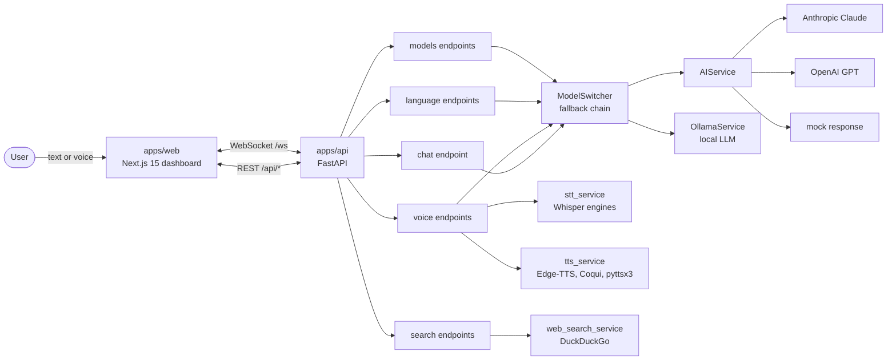
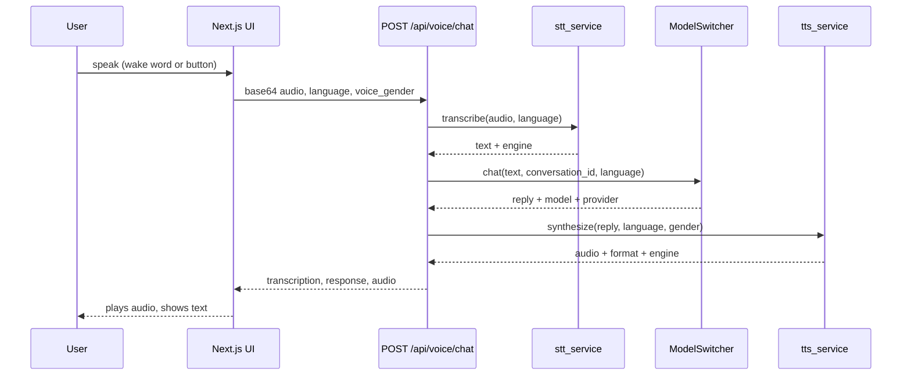
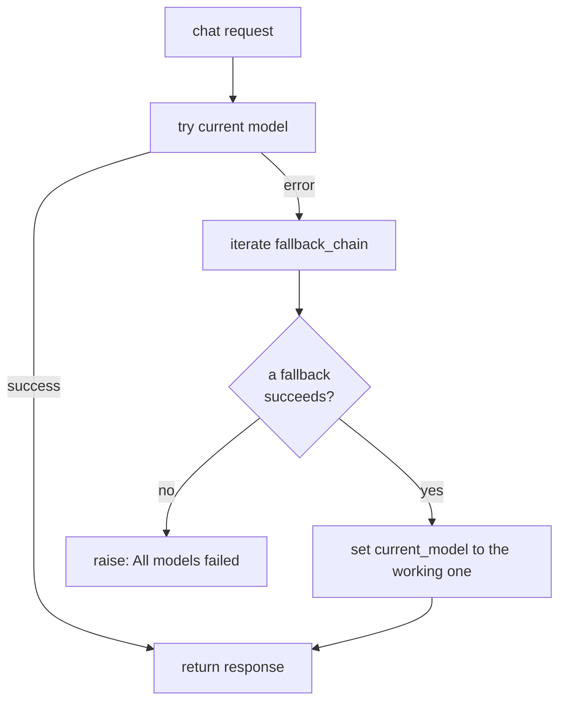

<div align="center">

# Luminous (javis)

**A personal, voice-enabled AI assistant (Thai and English) with cloud and local LLM fallback, built as a Next.js hologram dashboard on a FastAPI backend.**

     

</div>

<p align="center">
  
</p>

> **Status: working prototype, private project.** Chat, model switching, voice (STT/TTS), web search and a language-learning toolkit exist as API endpoints. Several items from the roadmap are not implemented (see Limitations). There are no automated tests in this repository.

Last updated: 2026-11-03.

---

## Problem and goal

Off-the-shelf assistants rarely handle Thai well, require a cloud connection, and lock you into one model provider. Luminous aims to be a personal "Jarvis" for its owner (Je): honest, knowledgeable, speaks Thai and English, works by text or voice, and keeps working offline by falling back to a local Ollama model.

## Design principles

| Principle | In the code |
|---|---|
| Provider-agnostic with fallback | `ModelSwitcher` tries the current model, then a fallback chain; the last resort is a mock response so the API never hard-crashes without keys. |
| Graceful voice degradation | `TTSService` holds engines in order: Edge-TTS, Coqui, pyttsx3; STT has Whisper and Faster-Whisper engines. |
| Thai first | Endpoints default to `language="th"`; the system prompt is chosen per language (`ai_service._get_system_prompt`). |
| Keys optional | `Settings.ANTHROPIC_AVAILABLE` / `OPENAI_AVAILABLE` treat placeholder values as "not configured". |

---

## Repository layout

```
javis/
├── apps/
│   ├── api/                     FastAPI backend
│   │   ├── src/main.py          app, lifespan, routers, /ws WebSocket
│   │   ├── src/api/endpoints/   chat, voice, models, language, search, health
│   │   ├── src/services/        ai_service, model_switcher, ollama_service,
│   │   │                        stt_service, tts_service, language_service,
│   │   │                        web_search_service, connection_manager
│   │   ├── src/core/            config (pydantic-settings), logger
│   │   ├── requirements.txt, pyproject.toml, INSTALL.md, .env.example
│   └── web/                     Next.js 15 frontend (App Router)
│       ├── src/app/             page, hands-free, voice-translate
│       ├── src/components/      dashboard, screens, HUD, particle background
│       ├── src/hooks/           useWakeWord, useVoiceRecognition, useTextToSpeech, ...
│       ├── src/lib/api.ts       REST + WebSocket client
│       └── public/              manifest.json, sw.js (PWA assets)
└── packages/
    ├── shared/                  shared types (package.json, src)
    └── config/                  shared ESLint / Prettier / tsconfig
```

---

## Tech stack

### Backend (`apps/api`)

| Layer | Choice |
|---|---|
| Framework | FastAPI >= 0.115.6, Uvicorn, Pydantic 2, pydantic-settings |
| LLMs | Anthropic SDK (>= 0.45.1), OpenAI SDK (>= 1.59.5), Ollama (local, via HTTP) |
| Speech | openai-whisper (in requirements); optional faster-whisper, Edge-TTS, Coqui TTS, pyttsx3 (commented/optional in `requirements.txt`) |
| Search | DuckDuckGo API by default (`WEB_SEARCH_API`), `httpx` |
| Declared for future use | SQLAlchemy + asyncpg (PostgreSQL), Redis, ChromaDB, sentence-transformers |
| Dev tooling (pyproject) | pytest, pytest-asyncio, black, ruff, mypy (configured, but no tests present) |

### Frontend (`apps/web`)

| Layer | Choice |
|---|---|
| Framework | Next.js 15.1.6, React 19, TypeScript |
| UI | Tailwind CSS 3, Radix UI, class-variance-authority, lucide-react |
| Motion / 3D | Framer Motion 11, Three.js, React Three Fiber, drei |
| State / charts | Zustand, Recharts |
| AI SDK | Vercel `ai`, `@ai-sdk/anthropic`, `@ai-sdk/openai` (declared dependencies) |
| Voice in browser | Web Speech API hooks: wake word, recognition, text-to-speech |

---

## System architecture



## Flow 1: Voice chat (STT, LLM, TTS)



## Flow 2: Model fallback



Inside `AIService.chat` the order is Anthropic first, then OpenAI, then a mock response. `ModelType` values are `cloud_anthropic`, `cloud_openai`, `local_ollama`, `mock`.

---

## API endpoints (`apps/api/src/main.py`)

| Prefix | Routes |
|---|---|
| `/` | `GET /` status; `WS /ws` real-time chat (`{"type": "chat", "message", "conversation_id"}`) |
| `/api/health` | `GET /`, `GET /detailed` |
| `/api/chat` | `POST /`, `GET /capabilities` |
| `/api/voice` | `POST /tts`, `POST /stt`, `POST /stt/upload`, `POST /chat`, `GET /engines` |
| `/api/models` | `GET /status`, `POST /set`, `GET /capabilities`, `GET /ollama/models`, `POST /ollama/pull`, `POST /ollama/chat`, `GET /ollama/recommendations`, `POST /ollama/set-default` |
| `/api/language` | `POST /translate/audio`, `/translate/text`, `/summarize`, `/grammar/check`, `/practice`, `/exercise/generate`, `/voice/learn`; `GET /features` |
| `/api/search` | `POST /web`, `POST /summarize_url`; `GET /status`, `GET /features` |

Interactive docs are served by FastAPI at `/docs` when the backend runs.

---

## Run

Backend (commands from the previous README and `apps/api/INSTALL.md`):

```bash
cd apps/api
pip install -r requirements.txt
cp .env.example .env          # then add keys if you want cloud models
python -m src.main            # http://localhost:8000
```

Frontend (scripts from `apps/web/package.json`):

```bash
cd apps/web
npm install
cp .env.local.example .env.local
npm run dev                   # http://localhost:3000
```

The frontend reads `NEXT_PUBLIC_API_URL` and `NEXT_PUBLIC_WS_URL`, defaulting to `http://localhost:8000` and `ws://localhost:8000/ws` (`src/lib/api.ts`).

Optional local LLM (from the previous README): `ollama serve`, then `ollama pull llama3.2:3b`. Switch models:

```bash
curl http://localhost:8000/api/models/status
curl -X POST http://localhost:8000/api/models/set -H "Content-Type: application/json" -d '{"model": "local_ollama"}'
```

Note: the previous README says `pnpm install` / `pnpm dev` from the repo root, but there is no root `package.json` or workspace file in this repository, so that path is unverified. Use the per-app commands above.

## Testing

No test files are committed. `pyproject.toml` configures pytest, ruff, black and mypy as dev tools, and the frontend has `npm run lint`. I did not run any of them.

## Security, privacy and limitations

- Secrets via `.env` (gitignored; only `.env.example` with placeholders is committed). `JWT_SECRET` defaults to `change-me-in-production` in `core/config.py`; JWT/auth endpoints are not present, so change it before adding auth.
- `CORS_ORIGINS` defaults to localhost origins. There is no authentication on any endpoint: do not expose the API publicly as-is.
- Voice audio and chat text are sent to whichever provider is active (Anthropic, OpenAI, or only local when `local_ollama` is selected). Use the local model for private content.
- `ai_service` pins model ids in code (`claude-sonnet-4-5-20241022`, `gpt-4o`); verify these against provider docs before relying on them.
- Conversation history, PostgreSQL, Redis and RAG memory are declared but not wired; `conversation_id` is passed through but replies are generated per message.
- Roadmap items still open (from the previous README): wake-word activation polish, camera/vision, object detection, real-time dashboards, RAG memory, multi-agent, mobile app.
- The previous README linked `docs/MODEL_ARCHITECTURE.md` and `docs/HANDS_FREE_GUIDE.md`; those files are not in this repository.

## License

Private project for Je. Not open source.
